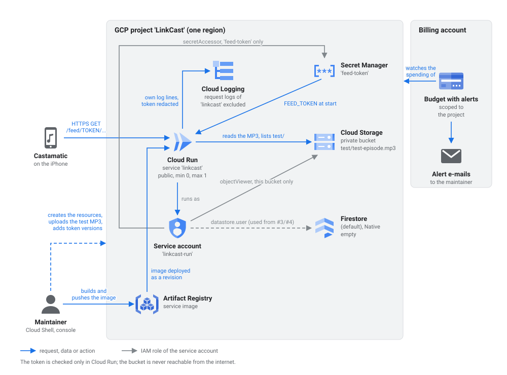

# Runbook: GCP project and Castamatic test

This runbook sets up the LinkCast infrastructure of issue #1 and proves that the privacy model (feed token in the address, private bucket) works in Castamatic. **The maintainer runs it by hand**, from the Google Cloud console and from Cloud Shell. Sessions never run any of it.



Read the whole runbook before starting. Do the steps in order: the Logging exclusion (step 3) must exist before the service is deployed (step 10), so that no request carrying the token is ever logged.

## Placeholders

Nothing real is written in this repository, which is public. Replace each placeholder when you type a command, and never paste the real value on GitHub.

| Placeholder | Meaning |
|---|---|
| `<PROJECT_ID>` | The id of the existing GCP project named LinkCast |
| `<BILLING_ACCOUNT_ID>` | The id of the billing account linked to the project |
| `<BUCKET_NAME>` | A globally unique bucket name you choose in step 5 |
| `<SERVICE_URL>` | The address Cloud Run gives to the service in step 10 |
| `<FEED_TOKEN>` | The random token made in step 7 |

## Choices of the design

- Region: `europe-west1` (Belgium) for every regional resource. The location of the bucket and of Firestore cannot be changed afterwards.
- Budget: **$5 per month**, with alerts at 50%, 90% and 100% of actual spending and at 100% of forecast spending.
- Service account `linkcast-run` gets `roles/datastore.user` in step 6. It is not used by #1; it is granted now so that later issues need no other IAM change. You may skip that one binding and grant it later.
- Cloud Run: minimum 0 and maximum 1 instance, 512 MiB, 1 vCPU, CPU only during requests.
- Only the resources and IAM roles named here are created. No service account key is ever created.

## Before you start

In Cloud Shell, open the project and the repository at the head branch of the final PR of #1 (the final PR is merged only after the Castamatic test):

```bash
gcloud config set project <PROJECT_ID>
gcloud config set run/region europe-west1
git clone https://github.com/nuccio/linkcast.git
cd linkcast
git checkout issue/1/base
```

Expected: `Updated property [core/project].`, then `Updated property [run/region].`, and the checkout succeeds.

## Step 1: Budget with alerts

In the console: Billing, select the billing account, Budgets & alerts, Create budget.

- Scope: only the project `<PROJECT_ID>`, all services.
- Amount: specified amount, **$5** per month.
- Alert thresholds: 50% actual, 90% actual, 100% actual and 100% forecasted.
- Notifications: e-mail to the billing account administrators.

Expected: the budget appears in the list with four alert thresholds. The budget only warns; it does not stop spending.

## Step 2: Enable the APIs

```bash
gcloud services enable run.googleapis.com firestore.googleapis.com \
  secretmanager.googleapis.com artifactregistry.googleapis.com
```

Expected: `Operation "operations/..." finished successfully.` Cloud Storage and Logging are already enabled. Do not enable Cloud Translation or Text-to-Speech: they are not part of #1.

## Step 3: Logging exclusion for the request log

Cloud Run's automatic request log records the full address, and so the token. Exclude it now, before the service exists.

In the console: Logging, Logs Router: edit the `_Default` sink, and under "Exclusion filters" add:

- Name: `linkcast-request-log`
- Filter:

```text
resource.type="cloud_run_revision"
resource.labels.service_name="linkcast"
log_id("run.googleapis.com/requests")
```

Expected: the exclusion is listed on the `_Default` sink, enabled. The service's own one-line logs (route, status, size, user agent; never the path) are in a different log and are not excluded. If this step is missed and the service has already been used, the token is in the logs: regenerate it (see "Regenerating the token").

## Step 4: Service account

```bash
gcloud iam service-accounts create linkcast-run \
  --display-name="LinkCast Cloud Run service"
```

Expected: `Created service account [linkcast-run].` The account address is `linkcast-run@<PROJECT_ID>.iam.gserviceaccount.com`.

## Step 5: Bucket

```bash
gcloud storage buckets create gs://<BUCKET_NAME> \
  --location=europe-west1 \
  --uniform-bucket-level-access \
  --public-access-prevention

gcloud storage buckets add-iam-policy-binding gs://<BUCKET_NAME> \
  --member="serviceAccount:linkcast-run@<PROJECT_ID>.iam.gserviceaccount.com" \
  --role="roles/storage.objectViewer"
```

Expected: `Creating gs://<BUCKET_NAME>/...`, then the updated IAM policy listing the binding. The bucket is private; only `linkcast-run` can read it, and only this bucket.

## Step 6: Firestore

```bash
gcloud firestore databases create --location=europe-west1 --type=firestore-native

gcloud projects add-iam-policy-binding <PROJECT_ID> \
  --member="serviceAccount:linkcast-run@<PROJECT_ID>.iam.gserviceaccount.com" \
  --role="roles/datastore.user" --condition=None
```

Expected: the `(default)` database is created in Native mode and stays empty; the policy output lists `roles/datastore.user` for `linkcast-run`. #1 writes nothing in it.

## Step 7: Secret with the feed token

Make the token in Cloud Shell and store it directly, without printing it:

```bash
python3 -c "import secrets; print(secrets.token_urlsafe(32), end='')" \
  | gcloud secrets create feed-token --data-file=-

gcloud secrets add-iam-policy-binding feed-token \
  --member="serviceAccount:linkcast-run@<PROJECT_ID>.iam.gserviceaccount.com" \
  --role="roles/secretmanager.secretAccessor"
```

Expected: `Created secret [feed-token].`, `Created version [1] of the secret [feed-token].`, then the policy listing the binding. To use the token in steps 11 and 12 read it into a shell variable of the same Cloud Shell session, never into a file or a message:

```bash
FEED_TOKEN=$(gcloud secrets versions access latest --secret=feed-token)
```

Never write the token in the repository, on GitHub or in a chat.

## Step 8: Upload the test episode

```bash
gcloud storage cp infra/test-episode.mp3 gs://<BUCKET_NAME>/test/test-episode.mp3
```

Expected: `Copying file://infra/test-episode.mp3 to gs://<BUCKET_NAME>/test/test-episode.mp3` and a completion line.

## Step 9: Artifact Registry and image

```bash
gcloud artifacts repositories create linkcast \
  --repository-format=docker --location=europe-west1
```

Expected: `Created repository [linkcast].` Now add a cleanup policy that keeps the last 2 images. A `Keep` policy alone deletes nothing, so the file has a `Delete` policy for everything else next to it. Save this as `~/cleanup.json` in Cloud Shell (your home directory, outside the repository):

```json
[
  {
    "name": "keep-last-2",
    "action": {"type": "Keep"},
    "mostRecentVersions": {"keepCount": 2}
  },
  {
    "name": "delete-others",
    "action": {"type": "Delete"},
    "condition": {"tagState": "any"}
  }
]
```

```bash
gcloud artifacts repositories set-cleanup-policies linkcast \
  --location=europe-west1 --policy="$HOME/cleanup.json" --no-dry-run
```

Expected: the command prints the two policies (`keep-last-2` and `delete-others`) now set on the repository; any image beyond the 2 most recent is deleted. Then build and push the image with Docker in Cloud Shell (it uses your own login and adds no IAM):

```bash
gcloud auth configure-docker europe-west1-docker.pkg.dev
docker build -t europe-west1-docker.pkg.dev/<PROJECT_ID>/linkcast/linkcast:v1 .
docker push europe-west1-docker.pkg.dev/<PROJECT_ID>/linkcast/linkcast:v1
```

Expected: the build ends with `Successfully tagged ...` and the push with a `digest: sha256:...` line.

## Step 10: Deploy the service

```bash
gcloud run deploy linkcast \
  --image=europe-west1-docker.pkg.dev/<PROJECT_ID>/linkcast/linkcast:v1 \
  --region=europe-west1 \
  --service-account=linkcast-run@<PROJECT_ID>.iam.gserviceaccount.com \
  --set-env-vars=AUDIO_BUCKET=<BUCKET_NAME>,AUDIO_PREFIX=test/ \
  --set-secrets=FEED_TOKEN=feed-token:latest \
  --min-instances=0 --max-instances=1 \
  --memory=512Mi --cpu=1 --cpu-throttling \
  --allow-unauthenticated
```

Expected: `Service [linkcast] revision [linkcast-00001-...] has been deployed and is serving 100 percent of traffic.` and a line `Service URL: <SERVICE_URL>`. Public access (`roles/run.invoker` for `allUsers` on this service only) is needed because a podcast app cannot log in; the token is the protection. If the command asks to enable an API or to create a repository, answer no and stop: it means a step above was missed.

Keep the address in a shell variable of the same session:

```bash
SERVICE_URL=$(gcloud run services describe linkcast --region=europe-west1 --format='value(status.url)')
```

## Step 11: Checks from Cloud Shell

Run each check and compare with the expected status:

```bash
# Feed with the right token: 200
curl -s -o /dev/null -w '%{http_code}\n' "$SERVICE_URL/feed/$FEED_TOKEN/feed.xml"

# MP3 with the right token and a byte range: 206
curl -s -o /dev/null -w '%{http_code}\n' -H 'Range: bytes=0-1023' \
  "$SERVICE_URL/feed/$FEED_TOKEN/episodes/test-episode.mp3"

# Wrong token: 404 for both
curl -s -o /dev/null -w '%{http_code}\n' "$SERVICE_URL/feed/wrong-token/feed.xml"
curl -s -o /dev/null -w '%{http_code}\n' "$SERVICE_URL/feed/wrong-token/episodes/test-episode.mp3"

# No token: 404 for both
curl -s -o /dev/null -w '%{http_code}\n' "$SERVICE_URL/feed/feed.xml"
curl -s -o /dev/null -w '%{http_code}\n' "$SERVICE_URL/feed//feed.xml"
curl -s -o /dev/null -w '%{http_code}\n' "$SERVICE_URL/episodes/test-episode.mp3"
```

Expected output, in order: `200`, `206`, then `404` five times. If a result differs, stop: the first two failing means the deploy or the bucket access is wrong; a 200 or 206 where a 404 is expected is a bug in the service, to be fixed in the final PR before merging.

Also check that the request log is not recording the token: in Logging, the log `run.googleapis.com/requests` of the service `linkcast` must show no new entries for these requests.

## Step 12: Castamatic test (PA16)

Done on the iPhone. The full address is `<SERVICE_URL>/feed/<FEED_TOKEN>/feed.xml`; send it to the phone by a private channel you trust and do not post it anywhere.

1. **Subscribe with the token in the address.** In Castamatic add a podcast by address and paste the full address. Expected: the show "LinkCast (test)" appears with one episode.
2. **Download with the same token.** Download the test episode and play it to the end. Expected: it downloads and plays; the service's log shows `episode` requests answered 200 or 206.
3. **Refresh in the background.** In Cloud Shell upload a second copy under another name, without deploying:

   ```bash
   gcloud storage cp gs://<BUCKET_NAME>/test/test-episode.mp3 gs://<BUCKET_NAME>/test/test-episode-2.mp3
   ```

   Do not open Castamatic. Expected: within a few hours it shows the second episode (notification or badge). Then delete the second copy:

   ```bash
   gcloud storage rm gs://<BUCKET_NAME>/test/test-episode-2.mp3
   ```

4. **The token is required.** From Safari on the iPhone or from Cloud Shell, the feed and the MP3 with a wrong token and without a token answer 404 (the checks of step 11).
5. **Who fetches the feed.** The user agents in the service's own log tell whether the refresh comes from the iPhone or from Castamatic's own servers. If it comes from their servers, the token leaves your devices: record this and decide whether it is acceptable.

### Recording the outcome

Write a comment on issue #1 with one line per point, each marked works, does not work, or notes. Never include the token, the service address, the project id or the bucket name. Example shape:

```text
PA16 outcome
1. Subscribe: works
2. Download: works
3. Background refresh: works / does not work (notes)
4. Token required (404 without it): works
5. Who fetches the feed: iPhone / Castamatic servers (decision)
```

### If it fails

- Points 1 or 2 fail: D15 and D20 do not stand as written. This is the maintainer's decision: try another podcast app (only the test changes), or open an issue to change D15 (HTTP Basic authentication or another mechanism), which needs its own design. #1 stays open and the final PR stays unmerged until you decide.
- Only point 3 fails: D15 and D20 stand. Record that new episodes appear only when Castamatic is opened, and decide whether that is enough for the MVP.
- Point 4 fails: it is a bug in the service, fixed in the same final PR before merging.

## Regenerating the token

Add a new version and deploy a new revision. The old address stops working and Castamatic must be subscribed again.

```bash
python3 -c "import secrets; print(secrets.token_urlsafe(32), end='')" \
  | gcloud secrets versions add feed-token --data-file=-

gcloud run services update linkcast --region=europe-west1 \
  --set-secrets=FEED_TOKEN=feed-token:latest
```

Expected: `Created version [2] of the secret [feed-token].` and a new revision serving 100 percent of traffic. Before running the checks of step 11 again, read the new token into the shell variable (the old value no longer works):

```bash
FEED_TOKEN=$(gcloud secrets versions access latest --secret=feed-token)
```

## Teardown

If the project is abandoned, remove every resource of this runbook, in this order:

```bash
gcloud run services delete linkcast --region=europe-west1
gcloud artifacts repositories delete linkcast --location=europe-west1
gcloud secrets delete feed-token
gcloud storage rm --recursive gs://<BUCKET_NAME>
gcloud firestore databases delete --database='(default)'
```

Before the service account is deleted, remove its project-level binding (the deletion does not remove it, and it would stay in the policy as a deleted account):

```bash
gcloud projects remove-iam-policy-binding <PROJECT_ID> \
  --member="serviceAccount:linkcast-run@<PROJECT_ID>.iam.gserviceaccount.com" \
  --role="roles/datastore.user" --condition=None

gcloud iam service-accounts delete linkcast-run@<PROJECT_ID>.iam.gserviceaccount.com
```

Then in the console: delete the Logging exclusion `linkcast-request-log` from the `_Default` sink, delete the budget, and optionally disable the APIs enabled in step 2. Each command asks for confirmation. The bucket and secret bindings disappear with the bucket and the secret.
